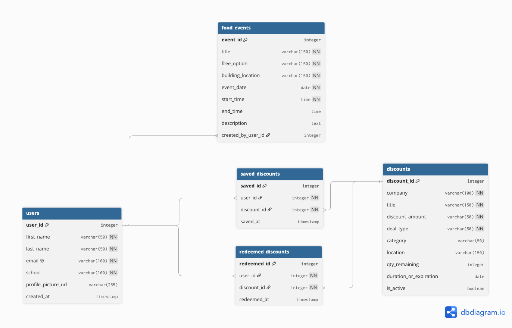

Read Me
//This is a test to see if i can still deploy stuff on vercel\\ lot is also testing this....... yay
# BYU Student Discounts and Free Food
## App Summary
BYU students can have trouble finding discounts that apply to them because offers are spread across different providers and sources. They may also miss free food events when event dates and locations are hard to keep track of. This app gives BYU students one place to find relevant discounts and campus food offerings. The Discount Dashboard lets students browse, search, filter, and save discounts. The Starving Student Card Hub lists card deals and helps students track which ones they have used, while the Free Food Near Me page and Calendar show upcoming food events. An interactive map shows where discounts and food offerings are located, and “Your Hub” brings saved discounts and events together.
## ERD
The ERD includes the `users`, `discounts`, `saved_discounts`, `redeemed_discounts`, and `food_events` entities.

 

## Tech Stack
Our team chose **Supabase as a backend-as-a-service**, with PostgreSQL as the database. We are using React and Vite for the frontend and Tailwind CSS for styling.
Supabase fits our team because it is accessible and provides a shared database without requiring us to build and maintain a separate backend server. PostgreSQL supports the foreign-key relationships in our data model, and the Supabase dashboard lets us view tables, add sample data, and check whether changes persist. Supabase also generates APIs from the database tables, which helps connect the frontend to the database without writing server routes from scratch. We chose this approach over Lovable because we can work directly with the database and avoid depending on a limited supply of AI-builder tokens. We will keep configuration in environment variables and exclude the `.env` file from Git.
## How to Get It Running

The project url is : studeats.vercel.app
> Check the repository’s `package.json` and Supabase setup, then replace the bracketed instructions with the exact steps for this project.
1. Clone the repository:
   git clone https://github.com/ThirstyCarrot/exact-pixel-match-94.git
2. Open the project directory:
   cd exact-pixel-match-94
3. Install the project dependencies:
   npm install
4. Configure the Supabase connection:
 	Your team must have a Supabase account. To create or access the project:
Go to https://app.supabase.com/
Log in with your team’s shared account (or invite your teammates to a new organization).
Click New Project.
Choose:
Project name (e.g., exact-pixel-match)
Region closest to your users
Database password (store in a .env file, never commit it)
After creation, you’ll see:
Project URL
anon key
service role key
	Required Environment Variables:
		Create a .env file in the project root containing these variable names:
VITE_SUPABASE_URL=
VITE_SUPABASE_ANON_KEY=
		If the project uses server-side Supabase (Node backend), you may also see:
SUPABASE_URL=
SUPABASE_SERVICE_ROLE_KEY=
SUPABASE_DB_PASSWORD=
		But never put the service role key or DB password in the frontend code.
	
How to Create or Seed the database:
		If your project includes SQL migrations or a schema file, you have two options:
Option 1 - Use Supabase Dashboard
Open your project → SQL Editor
Paste your schema SQL (tables, enums, policies)
Click Run
			

Option 2 - Use Supabase CLI (recommended for teams)
				If your repo contains a “supabase/” folder:
					In your terminal:
					npm install --save-dev supabase
npx supabase link --project-ref <PROJECT_REF>
npx supabase db push
				This applies all migrations automatically.
If the repo does not include migrations, you must manually create the tables in the dashboard or generate them using Supabase AI.

5. Start the app:
 	Correct start command:
In your Terminal:
npm run dev
Where the app opens:
 http://localhost:5173
If the project uses a different dev server (rare), the terminal will print the correct URL after running the command.

## Verifying the Vertical Slice

> Describe the button or action that updates the database. Give someone unfamiliar with the project enough information to test it.
- **Page or screen:** `[ENTER WHERE TO FIND THE ACTION]` Click the “Pin an item” button on the page.
- **Button or action:** `[ENTER WHAT TO CLICK OR SUBMIT]` Click the star next to your desired item!
- **Expected UI change:** `[DESCRIBE WHAT CHANGES ON SCREEN]` You should see your item pop up under “pinned items” on the page.
- **Database change:** `[NAME THE TABLE AND VALUE THAT SHOULD CHANGE]` The database adds rows for each pinned item, and deletes them as well.
- **Refresh check:** `[EXPLAIN HOW TO REFRESH AND CONFIRM THE CHANGE IS STILL THERE]` Click the classic f5 or reload the page, your pinned item will still be under “pinned items”!
